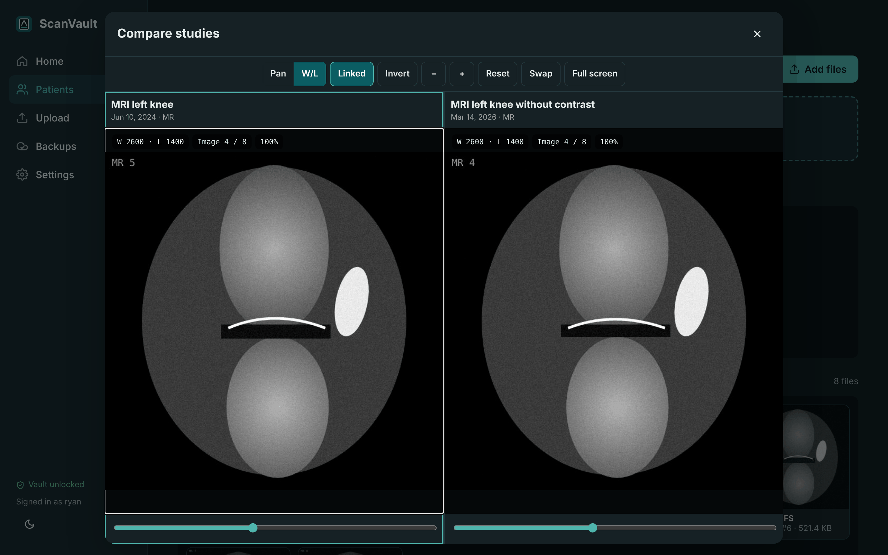
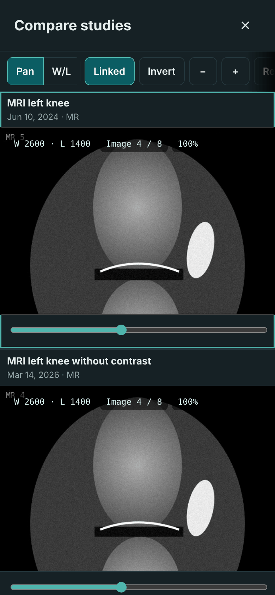

# ScanVault

Self-hosted, encrypted vault for medical imaging. Upload the DICOM studies,
film photos and PDF reports that imaging centers hand you, keep organized
local copies per patient, and back them up **encrypted** to Google Drive,
OneDrive, Dropbox, Box, S3-compatible storage (AWS, Backblaze B2, Wasabi,
Cloudflare R2, Synology C2, MinIO), SFTP/SCP, SMB shares, WebDAV/Nextcloud or
a USB disk.

- **Multi-patient**: one record per person (you, kids, parents), each with a
  timeline of studies.
- **Any upload**: single DICOMs, whole CD/zip exports (DICOMDIR, viewers and
  autorun junk are skipped), JPG/PNG/HEIC photos, PDF reports. DICOMs are grouped
  into studies by `StudyInstanceUID`. Date, modality, center and description are
  filled in from the tags. Reports uploaded together with one DICOM study join it.
- **Viewer**: true window/level on the original DICOM pixel values (drag
  sideways for window and up/down for level, or type values; CT presets for
  brain, subdural, stroke, soft tissue, mediastinum, liver, lung and bone). It
  also has zoom toward the cursor, Ctrl+scroll, pinch, double-tap, pan, invert,
  scroll or slider through a series, a frame slider for multi-frame files,
  fullscreen and keyboard shortcuts. Photos get the same tools in the browser.
  PDFs open inline.
- **Compare side by side**: put two studies of the same patient next to each
  other (prior on the left, current on the right). Suggested matches come first:
  same type of scan and body part, closest in time. Zoom, pan, window/level,
  invert and slice scrolling stay linked; unlink to line up anatomy, then relink
  and both sides keep that offset. Stacks top and bottom on a phone.
- **Themes**: light, dark or match device, with a choice of dark color (six
  presets or any custom color). Saved per account, so it follows you across
  devices.
- **Mobile and web**: responsive UI, installable as a PWA (Add to Home Screen),
  with a "Take photo" button for paper reports and films. A REST API with
  Bearer tokens serves native clients.
- **Encrypted at rest**: every file, preview, patient/study record and stored
  cloud credential is encrypted with AES-256-GCM.
- **Encrypted backups**: one archive per run, encrypted before it leaves the
  box, with schedule and retention per destination.
- **Your key**: you set the encryption key at first run and download a
  **recovery key file** for emergency restore. `tools/restore.py` decrypts
  any backup into plain folders without ScanVault running at all.

## Screenshots

All screenshots use the default dark theme and the built-in sample vault
(fictional patients and synthetic scans, no real data).


<table>
<tr>
<td width="50%"><br><sub><b>Patient timeline.</b> One record per person, studies newest first.</sub></td>
<td width="50%"><br><sub><b>DICOM viewer.</b> True window/level in HU (here the Lung preset, -600/1500).</sub></td>
</tr>
<tr>
<td><br><sub><b>Study.</b> Reports and images, with tags filled in from DICOM.</sub></td>
<td><br><sub><b>Patients.</b> Search by name, MRN or date of birth.</sub></td>
</tr>
<tr>
<td><br><sub><b>Backups.</b> Per-destination schedule, retention and run history.</sub></td>
<td><br><sub><b>Settings.</b> Theme, dark color presets and key fingerprint.</sub></td>
</tr>
<tr>
<td colspan="2"><br><sub><b>Compare.</b> Prior and current study side by side, zoom, window/level and slices linked.</sub></td>
</tr>
</table>

<p>




</p>

## Quick start

```bash
git clone https://github.com/ryanbyte1701/scanvault && cd scanvault
docker compose up -d --build
open http://localhost:8080
```

First run walks you through:

0. **Setup code**: printed in the container log (`docker logs scanvault`) when
   ScanVault starts unconfigured. It stops anyone else on the network, or a
   web page in your browser, from claiming the vault before you do. You can
   preset it with `SCANVAULT_SETUP_CODE`.
1. **Sign-in**: username and password for the web/mobile UI.
2. **Encryption key**: a passphrase of 12+ characters (or click *Generate*
   for six words from the EFF list, about 77 bits). It is separate from the
   sign-in password.
3. **Recovery key file**: download `scanvault-recovery-key.txt`, then
   upload it back to prove you saved it. Print it or keep it offline.

<table>
<tr>
<td width="50%"></td>
<td width="50%"></td>
</tr>
</table>

Data lives in the `scanvault-data` volume (`/data` in the container).

The compose file publishes the port on `127.0.0.1` only. To use ScanVault from
other devices put an HTTPS reverse proxy in front of it (Caddy, Traefik, nginx,
Tailscale Serve, your NAS's proxy). `FORWARDED_ALLOW_IPS` says who may set
`X-Forwarded-Proto`; the compose file trusts `127.0.0.1` and the Docker bridge
(`172.16.0.0/12`), which is where a proxy on the same host connects from. Set
it to your proxy's address if the proxy runs elsewhere. Over plain `http://`
the setup screen warns you that keys would cross the network in clear.

A bare `docker run -p 8080:8080` publishes plain HTTP on every interface of
the host. Use `-p 127.0.0.1:8080:8080` and a proxy instead, as the compose
files do.

**Synology NAS:** see [deploy/synology/README.md](deploy/synology/README.md)
for a Container Manager project with `/volume1` paths, PUID/PGID, a DSM reverse
proxy with HTTPS, and backup tips. Prebuilt multi-arch images (amd64 and arm64)
are published to `ghcr.io/ryanbyte1701/scanvault` on every merge to `main`.

The container starts as root only to set the owner of `/data` to
`PUID:PGID` (default `10001`), then drops to that user. The compose files run
it with a read-only root filesystem, a small `/tmp` tmpfs, all capabilities
dropped except the few the entrypoint needs, and `no-new-privileges`.

### Locking and restarts

The master key only lives in memory. After a container restart the vault is
**locked**: sign in, then enter the encryption key (or upload the recovery
key file) to unlock. Scheduled backups pause while locked.

For unattended servers you can opt into auto-unlock with a Docker secret
(`SCANVAULT_PASSPHRASE_FILE`, see `docker-compose.yml`). The trade-off is that
anyone who has the host disk also has the key. A missing or unreadable file is
logged and the vault stays locked.

`SCANVAULT_AUTO_LOCK_MINUTES` (default `0`, off) locks the vault after that
many idle minutes. Sessions last at most 30 days and end after
`SCANVAULT_SESSION_IDLE_DAYS` (default 14) without use. Changing the sign-in
password signs out every other device; Settings also has *Sign out other
devices*. Sign-in, unlock and key checks are rate limited (5 free failures,
then growing delays, per client and per account). A browser or app that has
signed in to that account before holds its own random device token and is
limited per device instead, so failed guesses from strangers can't lock you
out of your own vault. Changing the password retires every device token.

New encryption keys are checked for strength: four or more random words, or
a long mix of letters, digits and symbols. Common passwords and repeated
characters are refused.

### Phones

Open the server's address on the phone and use **Add to Home Screen**. Outside
your LAN, put ScanVault behind HTTPS (Caddy, Traefik, Tailscale Serve,
Cloudflare Tunnel) and set `SCANVAULT_PUBLIC_URL`.

### Single sign-on (SSO)

ScanVault can sign you in through any OpenID Connect provider: Google,
Microsoft (personal or Entra ID), Authentik, Authelia, Keycloak, Synology SSO
Server, or anything else that publishes `/.well-known/openid-configuration`.
Password sign-in keeps working unless you turn it off.

1. **Settings > Single sign-on > Add provider.** Pick a preset, copy the
   redirect URI it shows (`<your address>/api/auth/sso/callback`) into the
   provider's app registration, and paste the client ID and secret back.
   ScanVault checks the provider's configuration before saving.
2. **Link my account.** You confirm your ScanVault password (adding a
   provider, linking an account and turning password sign-in off all ask for
   it, unless you signed in with SSO in the last 10 minutes), then sign in at
   the provider once; that identity is now
   tied to your ScanVault login. Only linked identities can sign in, so being
   known to the provider is never enough on its own.
3. Optionally untick **Allow password sign-in**. ScanVault refuses to do this
   until an account is linked, and turns it back on if the last link is
   removed. If the provider is ever down, start the container with
   `SCANVAULT_FORCE_LOCAL_LOGIN=1` to get password sign-in back.

**SSO does not unlock the vault.** It replaces the sign-in password only. The
encryption key never goes to the identity provider, so after a restart you
still enter the encryption key (or upload the recovery key file, or use
`SCANVAULT_PASSPHRASE_FILE`) exactly as before.

Notes:

- Set `SCANVAULT_PUBLIC_URL` when ScanVault sits behind a reverse proxy, so the
  redirect URI matches what you registered.
- Self-hosted providers need a certificate ScanVault trusts. For a private CA
  (for example a Synology self-signed certificate), mount the CA file and set
  `REQUESTS_CA_BUNDLE=/path/to/ca.pem`. Plain `http://` issuers are refused
  unless you set `SCANVAULT_OIDC_ALLOW_HTTP=1` (trusted LAN only).
- Instead of the UI you can configure one provider with environment variables:
  `SCANVAULT_OIDC_ISSUER`, `SCANVAULT_OIDC_CLIENT_ID`,
  `SCANVAULT_OIDC_CLIENT_SECRET` or `SCANVAULT_OIDC_CLIENT_SECRET_FILE`,
  and optionally `SCANVAULT_OIDC_NAME`, `SCANVAULT_OIDC_PRESET`
  (`google`, `microsoft`, `authentik`, `authelia`, `keycloak`, `synology`,
  `generic`) and `SCANVAULT_OIDC_SCOPES`.
- Client secrets entered in the UI are stored in the server's database (inside
  the `/data` volume and inside encrypted backups), not under the vault key,
  because sign-in has to work while the vault is locked. Use
  `SCANVAULT_OIDC_CLIENT_SECRET_FILE` with a Docker secret if you prefer.
- An identity signs in only through the provider entry it was linked with.
  Unlinking it, removing or disabling its provider, or pointing the provider
  at a different issuer or client ID ends the sessions it created.
- SAML is not supported. Every provider listed above speaks OpenID Connect.

## Backup destinations

Every backup is a single `scanvault-backup-<vault id>-YYYYMMDD-HHMMSSZ-<rand>.svb`
file, encrypted with your master key before upload. Each destination has its
own schedule (hours, `0` = manual; a failed run is retried after an hour) and
retention (keep last N). Retention only deletes backups of the same vault, so
several servers can share a folder. Backups from 0.1 (no vault id in the name)
are never pruned automatically.

The archive is streamed straight into the encryption (no plaintext tar on
disk) and is a consistent snapshot: files deleted while a backup runs are
removed only after it finishes. Session tokens are never included.

| Destination | Auth options | Notes |
|---|---|---|
| **Google Drive** | Google account (OAuth, `drive.file` scope) or service account JSON | For OAuth create a *Web application* client in Google Cloud Console, enable the Drive API, add the redirect URI shown in the form, then click *Connect*. Service accounts need a Shared Drive folder shared with them. Uploads are resumable in 8 MiB chunks. |
| **Box** | Box account (OAuth 2.0) or Custom App with Client Credentials Grant | Rotating refresh tokens are persisted after each use. Files over 50 MB use chunked upload sessions with SHA-1 digests. |
| **OneDrive** | Microsoft account or work/school (Entra ID app, delegated `Files.ReadWrite.AppFolder offline_access`) | Register an app, add the redirect URI shown in the form as a *Web* platform, create a client secret, then click *Connect*. Backups go to the app's own folder (`Apps/<app name>`); the token can't read the rest of the drive. Upload sessions in 10 MiB chunks. Rotated refresh tokens are saved. **Upgrading from 0.1:** add the narrower permission to the app registration and click *Connect* again; backups made before the upgrade stay in the drive root (they aren't listed or pruned any more, so move them into `Apps/<app name>` or delete them yourself). |
| **Dropbox** | Dropbox app (scoped, App folder or Full Dropbox), offline refresh token | Permissions: `files.content.write`, `files.content.read`, `files.metadata.read`. Files over 150 MB use upload sessions. |
| **S3 / object storage** | Access key + secret (required; the host's own credentials are never used) | Presets for Amazon S3, Backblaze B2, Wasabi, Cloudflare R2, Synology C2 and MinIO, or any `https://` endpoint URL. Multipart uploads, optional storage class and prefix. Bucket versioning or object lock is recommended. With a write-only key set *Keep last* to 0 and expire old backups with a lifecycle rule. |
| **SFTP / SCP** | Password and/or private key (Ed25519, ECDSA, RSA) | The first *Test* only fetches and pins the server's host key, without signing in; compare the fingerprint it shows with the server's, then press *Test* again. A changed key blocks the connection, and changing the host or port asks for the password or key again. Both protocols upload to `.part` and rename only a complete file; failed uploads are cleaned up. |
| **SMB share** | Username + password (`DOMAIN\user` supported) | SMB 2/3 to Windows, Synology, QNAP, TrueNAS or Samba, SMB3 encryption is required unless you turn it off. Writes `.part` then renames. |
| **WebDAV / Nextcloud** | Username + password or app password | HTTPS only. Nextcloud/ownCloud (`…/remote.php/dav/files/USER`), Synology WebDAV Server, Koofr, pCloud and others. A self-signed certificate is pinned by SHA-256 fingerprint on the first *Test* instead of turning checks off. Creates folders and uploads `.part` then MOVE. |
| **USB / local disk** | None | Any folder mounted into the container under `/backups` (USB drive, second disk, NFS mount); other paths are refused. By default it refuses to run if no disk is mounted there, so backups never fill the system drive. |

You can also click **Download backup** to save an encrypted `.svb` locally.

## Emergency restore

**Into ScanVault**: on a fresh install choose *Restore from a backup*, enter
the setup code, upload the `.svb` and your recovery key file, and choose a new
sign-in. Restored destinations start paused, so the new server doesn't write
to (and prune) the old one's destinations until you turn them back on.

By default backups can only be opened with the recovery key file. Settings ›
Encryption › *Allow restoring backups with the encryption key alone* adds a
passphrase-wrapped copy of the key to new backups (convenient, but a stolen
backup can then be attacked by guessing the passphrase offline).

**Over a running vault** (Backups › Restore): patients, studies and files are
replaced with the backup's; logins, sessions, the current encryption key,
settings, destinations and backup history stay as they are.

**Without ScanVault** (e.g. years later, server gone):

```bash
pip install cryptography
python3 tools/restore.py --backup scanvault-backup-20261126-213000Z.svb \
    --key scanvault-recovery-key.txt --out ./restored
```

This writes `restored/<Patient (DOB)>/<date title - center>/<files>` plus a
`patients.json` index (always written, even if some files fail; those are
listed and the tool exits with status 1). Use `--passphrase` instead of `--key`
to be prompted for the encryption key, for backups made with passphrase
restore turned on.

## Security design

- **Master key (MK)**: 32 random bytes. The passphrase is stretched with scrypt
  (N=2^17, r=8, p=1; older keystores are upgraded at the next unlock) and wraps
  the MK with AES-256-GCM in `keystore.json`. Changing the passphrase re-wraps
  the MK, so data, backups and the recovery file stay valid.
- **Key rotation**: Settings › Encryption › *Replace the master key* re-encrypts
  every file, preview and record under a new MK and issues a new recovery key
  file. The old recovery file then opens nothing made afterwards (it still
  opens backups made before). The change is journaled, so an interrupted
  rotation is finished or rolled back at the next start.
- **Recovery key file**: the MK in base32 with a 4-byte checksum and a
  fingerprint, so typos and mismatched vaults are caught.
- **Files**: streamed AES-256-GCM in 1 MiB chunks with a per-file HKDF subkey.
  The nonce encodes the chunk counter and a final-chunk flag, which detects
  truncation and reordering. The file id is bound as associated data, so blobs
  can't be swapped between records.
- **Metadata**: patient names, DOB, MRN, notes, study details, file names,
  file digests and DICOM tags are sealed per row (bound to the row id). The
  database keeps only a keyed HMAC of each file's SHA-256 for duplicate
  detection, so it can't be used to confirm that a known document is in the
  vault. Row counts, sizes and timestamps are not hidden.
- **Processing**: uploads are streamed (after authentication, with size
  limits) into scratch files encrypted with a random key that exists only in
  memory and are unlinked on creation; zip members and DICOM decoding use the
  same scratch files, so no plaintext reaches the disk. Zip and DICOM
  decompression bombs are refused (per-member and total limits, frame size
  checks, one frame decoded at a time).
- **Web**: HttpOnly SameSite=Strict session cookie plus a required
  `X-ScanVault` header on every cookie-authenticated state-changing request.
  The browser never sees the session token (it is only returned in JSON to API
  clients). JSON endpoints only accept `application/json`. Content-Security-Policy
  and (over HTTPS) HSTS on every page. Decrypted content, thumbnails and
  renders are `no-store`. Uploaded content is served inline only for images
  and PDFs; everything else is forced to download. The service worker never
  caches `/api/` responses. `/api/docs` is off unless `SCANVAULT_API_DOCS=1`.
  The container runs as a non-root user.
- **SSO**: OpenID Connect authorization code flow with PKCE (S256), `state`
  and `nonce`. ID tokens are checked against the provider's JWKS (asymmetric
  algorithms only), issuer, audience, expiry and nonce. The browser that
  started a sign-in is bound to it with a short-lived cookie; the session is
  then issued by a same-origin request that trades a one-time, 2-minute ticket.
  Identities are matched by issuer and subject, never by e-mail.

### HIPAA and privacy notes

- Keeping your own or your family's records generally isn't covered by HIPAA.
  If a covered entity (a practice, clinic or billing service) uses ScanVault for
  patients, it is responsible for HIPAA's administrative, physical and technical
  safeguards. That includes a BAA with Google or Box even though they only
  receive ciphertext, plus access logging, its own risk analysis and backups of
  the recovery key.
- Cloud providers see backup sizes, times and file names (which contain no PHI).
- There is no key escrow. If you lose both the encryption key and the recovery
  key file, the data cannot be recovered.

## API (for the Android app and scripts)

Interactive docs: set `SCANVAULT_API_DOCS=1`, then `http://localhost:8080/api/docs`.
Authenticate with `POST /api/auth/login {username, password}` → `{token, expires_at}`
(the token is in the body for API clients, i.e. requests without the browser's
`X-ScanVault` header), then send `Authorization: Bearer <token>`. Errors are
`{"error": "...", "code"?: "..."}`, including validation errors (400). Too many
failed sign-ins or key checks return **429** with `Retry-After`. A successful
password sign-in also returns `device`: send it back as `device` in later
`/api/auth/login` bodies so the per-account lockout never applies to this
app (each device gets its own token). Changes return **503**
`{code: "maintenance"}` while the master key is being changed; sign-in and
reads keep working until the re-encryption itself starts. One upload request
takes at most 500 files.
A locked vault returns **423** `{code: "locked"}`; unlock with
`POST /api/vault/unlock {passphrase}`.

**SSO from an app.** `GET /api/status` lists `sso: [{id, name, preset}]` and
`local_login`. To sign in with a provider:

1. Make a PKCE pair: `code_verifier` (43 to 128 random URL-safe characters)
   and `code_challenge = base64url(sha256(code_verifier))` without padding.
2. Open `GET /api/auth/sso/{id}/start?app_redirect=scanvault://sso&app_state=<random>&code_challenge=<challenge>`
   in a browser tab (Android Custom Tab, iOS ASWebAuthenticationSession).
   `app_redirect` must start with a prefix from `SCANVAULT_SSO_APP_REDIRECTS`
   (default `scanvault://`).
3. After the provider, ScanVault shows its own confirmation page ("Sign in
   to the ScanVault app?") in the tab. Only when the person taps Continue does
   it redirect to `scanvault://sso?ticket=…&state=<app_state>`. Failures and
   Cancel go to `scanvault://sso?error=…&state=…`. Check `state`, and ignore
   callbacks when no sign-in is in progress.
4. `POST /api/auth/sso/exchange {ticket, code_verifier}` within 2 minutes
   returns `{token, expires_at, unlocked}`, the same as password sign-in.
   Unlock the vault with the encryption key as usual if `unlocked` is false.

What protects this flow: PKCE stops another app that *intercepts* the
redirect from using the ticket. It does not stop another app on the phone from
*starting its own* sign-in, because no app owns the `scanvault://` scheme. The
confirmation page is the defence against that, and Google and Microsoft are
also asked to show their account picker (`prompt=select_account`). If you
control a fixed domain for the app, you can instead list a verified Android App
Link such as `https://app.example.com/sso` in `SCANVAULT_SSO_APP_REDIRECTS`;
https entries match scheme, host and port exactly.

| Method | Path | |
|---|---|---|
| GET | `/api/health`, `/api/status` | liveness; setup/lock/auth state |
| GET/POST | `/api/patients` | list (with `study_count`, `file_count`) / create `{name, date_of_birth?, sex?, mrn?, notes?}` |
| GET/PUT/DELETE | `/api/patients/{id}` | |
| GET/POST | `/api/patients/{id}/studies` | `{title, modality?, study_date?, facility?, description?}` |
| POST | `/api/patients/{id}/import` | multipart `file` (repeatable). Auto-groups DICOM, expands zips. |
| GET/PUT/DELETE | `/api/studies/{id}` | |
| GET/POST | `/api/studies/{id}/files` | list / multipart `file` (repeatable) |
| GET | `/api/files/{id}`, `/content`, `/thumbnail` | metadata, decrypted bytes, JPEG preview |
| GET | `/api/files/{id}/render?wc=&ww=&frame=` | DICOM rendered with a window center/width in modality units (HU for CT). `X-Window-*`, `X-Default-*`, `X-Min/Max`, `X-Frames`, `X-Modality` headers |
| GET | `/api/auth/sso/{id}/start` | begin SSO sign-in (browser navigation; apps add `app_redirect`, `app_state`, `code_challenge`) |
| POST | `/api/auth/sso/exchange` | `{ticket, code_verifier?}` → session |
| POST | `/api/auth/sso/{id}/link` | signed in: returns `{url}` to link a provider account |
| GET | `/api/sso/config` | providers (secrets write-only), redirect URI, presets, your linked accounts |
| POST/PUT/DELETE | `/api/sso/providers[/{id}]` | `{preset, name, issuer?, fields?, client_id, client_secret?, scopes?, enabled?}` |
| PUT | `/api/sso/settings` | `{local_login: bool}` |
| DELETE | `/api/sso/identities/{id}` | unlink |
| GET/PUT | `/api/prefs` | `{theme: system\|light\|dark, dark_color: "#rrggbb"}` per user |
| POST | `/api/auth/logout-others` | sign out every other session |
| GET/PUT | `/api/vault/settings` | `{passphrase_restore: bool}` |
| POST | `/api/vault/rekey` | `{passphrase, new_passphrase?}` → `{recovery_key, fingerprint}` |
| GET/POST/PUT/DELETE | `/api/backups/targets[/{id}]` | destinations (secrets are write-only) |
| POST | `/api/backups/run`, `/api/backups/targets/{id}/run`, `/test` | |
| GET | `/api/backups/runs`, `/api/backups/download` | history; encrypted `.svb` download |

Files: `{id, study_id, patient_id, filename, content_type, size_bytes, kind: image|report|dicom|other, has_thumbnail, sha256, uploaded_at, dicom?}`.

## Development

```bash
pip install -r requirements-dev.txt
SCANVAULT_DATA=./data uvicorn app.main:app --reload --port 8080
pytest -q                     # crypto, API, restore tool, every backup destination
python3 tools/build_demo.py preview/index.html   # self-contained clickable demo, sample data only
python3 tools/screenshots.py  # regenerate docs/screenshots (needs playwright; dark theme, sample data)
```
